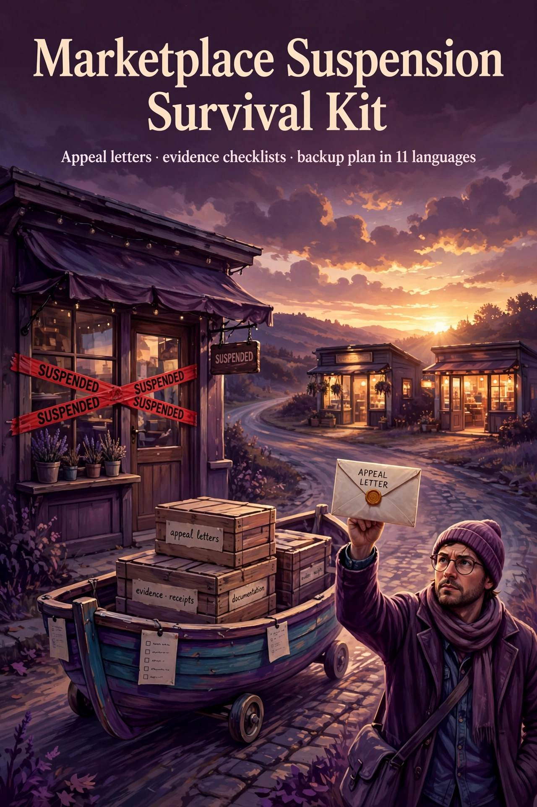

# Marketplace Suspension Survival Kit

**Your shop was suspended with no warning and no explanation — and it was your only income.** A 72-hour rescue plan for online marketplace sellers (Etsy-style shops, handmade, print-on-demand, digital products): 5 copy-paste appeal letters, evidence checklists, a fee-dispute template, and a business-continuity playbook — in 11 languages, with honest limits stated up front.

> "The sellers who win appeals are the ones with documented facts, calm language, and a paper trail."

## What's inside (12 files)

| # | File | What it is |
|---|---|---|
| 00 | READ-ME-FIRST.txt | Start here — file map + honest limits |
| 01 | quick-start-guide-EN.pdf | 11 sections: the 72-hour plan (first 24h, first week, first 30 days) |
| 02–06 | 5 appeal letters (.docx, editable) | First appeal · escalation with new evidence · formal complaint (template, NOT legal advice) · fee dispute · data-export request. Every letter has a how-to box: when to send, what to attach, what to log |
| 07 | all-templates-checklists-faqs-11-languages.pdf | 216 pages: all 5 letters + 4 checklists + 6 FAQs + honest limits + start-here + 90-day recovery plan in EN · ZH · FR · ES · AR · RU · DE · JA · PT · HI · IT. `[BRACKET]` placeholders stay in English in every language |
| 08 | evidence-inventory-tracker.xlsx | What to screenshot/export before AND during a suspension — readiness % auto-calculates; 11-language labels |
| 09 | channel-diversification-planner.xlsx | What you'd lose if your main channel vanished: shortfall, cash runway, revenue-split targets |
| 10 | worked-example (PDF) | Fictional end-to-end illustration: a print-on-demand seller from suspension through appeal to rebuilding on two channels. All names/numbers invented |
| 11 | faqs-and-honest-limits-EN.pdf | 6 product-specific FAQs + explicit limits |

## Why this exists

Real public seller accounts — an October 2026 post about a shop (20 sales / 67 listings) suspended with an appeal the platform said it would "not reconsider"; reviews describing sudden permanent suspensions with no explanation and charges continuing after closure; a seller locked out of sales information for 12 days with no income; a Trustpilot review on held funds and unexpected fees. No statistics invented, no promises invented.

## Honest notes

- No letter or kit can force a platform to reinstate an account. The final decision is always the platform's.
- The formal complaint letter is a template, not legal advice. For large withheld sums, consult a real lawyer in your country.
- Platform policies change — verify current policy text before sending anything.
- One-time payment, no subscription, no login; your data stays on your machine.

## Get the kit — $29 one-time, Commercial license

- Getly: `https://www.getly.store/product/marketplace-suspension-survival-kit`
- SellApp (USDT): `https://digitaltoolkitstore.sell.app/product/marketplace-suspension-survival-kit`
- Watch the demo: `https://www.youtube.com/watch?v=WrYqcoPHxQ4`

*(URLs follow store convention — verified at publish.)*

---

## En français — Kit de survie en cas de suspension de boutique

Votre boutique suspendue sans avertissement ni explication — alors que c'était votre seul revenu. 5 lettres d'appel copier-coller, listes de preuves, modèle de contestation de frais et plan de continuité — en 11 langues, limites honnêtes incluses. 29 $ une seule fois, licence commerciale, sans abonnement.

**Acheter :** `https://www.getly.store/product/marketplace-suspension-survival-kit` · `https://digitaltoolkitstore.sell.app/product/marketplace-suspension-survival-kit`

## En español — Kit de supervivencia ante suspensiones

Tu tienda suspendida sin aviso ni explicación — y era tu único ingreso. 5 cartas de apelación listas para copiar, listas de evidencia, plantilla de disputa de cargos y plan de continuidad — en 11 idiomas, con límites honestos. 29 $ pago único, licencia comercial, sin suscripción.

**Comprar:** `https://www.getly.store/product/marketplace-suspension-survival-kit` · `https://digitaltoolkitstore.sell.app/product/marketplace-suspension-survival-kit`

## Auf Deutsch — Notfall-Kit bei Shop-Sperrung

Shop ohne Warnung und ohne Erklärung gesperrt — und es war dein einziges Einkommen. 5 kopierfertige Einspruchsschreiben, Beweis-Checklisten, Gebühren-Widerspruch und Kontinuitätsplan — in 11 Sprachen, mit ehrlichen Grenzen. 29 $ einmalig, kommerzielle Lizenz, kein Abo.

**Kaufen:** `https://www.getly.store/product/marketplace-suspension-survival-kit` · `https://digitaltoolkitstore.sell.app/product/marketplace-suspension-survival-kit`

## In italiano — Kit di sopravvivenza per sospensioni

Negozio sospeso senza preavviso né spiegazioni — ed era il tuo unico reddito. 5 lettere di ricorso pronte da copiare, checklist delle prove, modello di contestazione addebiti e piano di continuità — in 11 lingue, con limiti onesti. 29 $ una tantum, licenza commerciale, nessun abbonamento.

**Acquista:** `https://www.getly.store/product/marketplace-suspension-survival-kit` · `https://digitaltoolkitstore.sell.app/product/marketplace-suspension-survival-kit`

---

## Contact

- Telegram: https://t.me/Digitaltoolkitstore
- Email: poodepoo@gmail.com
